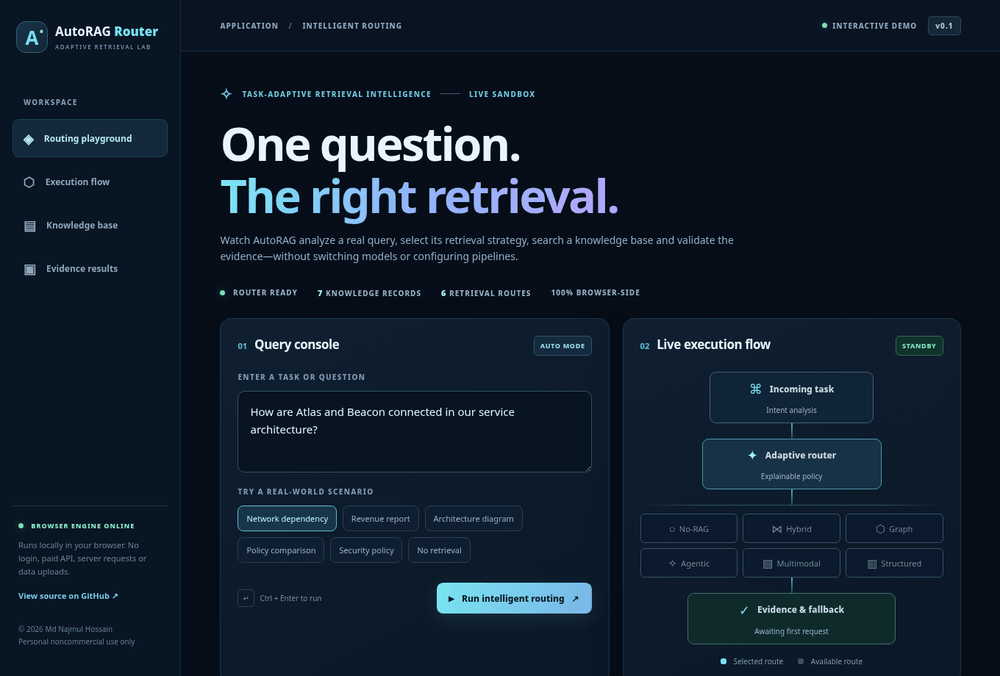
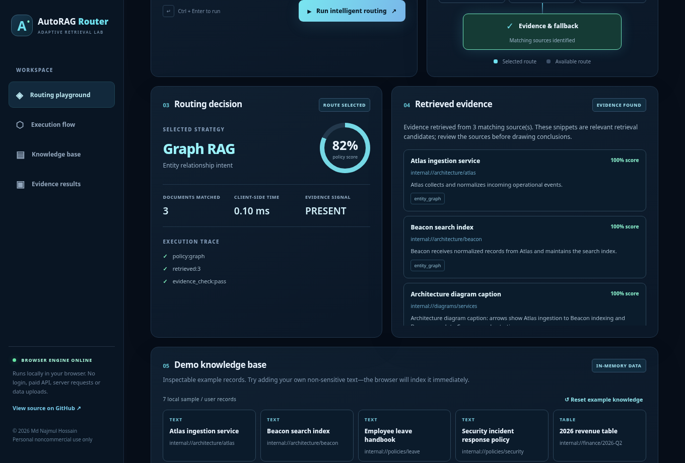

<div align="center">

# AutoRAG Router

### One task. The right retrieval strategy. Automatically.

**Explainable task routing · Hybrid search · Graph context · Adaptive fallback · Evidence-aware retrieval**

[](https://www.python.org/)
[](https://fastapi.tiangolo.com/)
[](https://github.com/hossain0707/AutoRAG-Router/actions/workflows/ci.yml)
[](https://autorag-router-demo.vercel.app/)
[](LICENSE)

**[📚 Project handover](PROJECT_CONTEXT.md)** &nbsp; · &nbsp; **[Development journal](docs/DAILY_LOG.md)** &nbsp; · &nbsp; [Continuity workflow](docs/WORKFLOW.md)

**[▶ Open the live interactive demo](https://autorag-router-demo.vercel.app/)** &nbsp; · &nbsp; **[Watch real app walkthrough](assets/real-router-walkthrough.mp4)** &nbsp; · &nbsp; [Run locally](#quick-start) &nbsp; · &nbsp; [Architecture](#architecture) &nbsp; · &nbsp; [License](#license--commercial-use)



<sub>Actual recorded interactions with the browser-side demo · Synthetic example documents · No paid model or external service</sub>

</div>

---

## Continue in a new ChatGPT or coding-agent session

Start with **[PROJECT_CONTEXT.md](PROJECT_CONTEXT.md)** and **[AGENTS.md](AGENTS.md)**, then read the **[human changelog](CHANGELOG.md)**, **[daily change journal](docs/DAILY_LOG.md)** and **[workflow](docs/WORKFLOW.md)**. The journal captures verified Git additions, modifications, removals and renames through an automated GitHub Actions workflow. Deployment status and architectural decisions must also be verified and written by the agent after relevant changes.

## What is AutoRAG Router?

A conventional retrieval-augmented generation pipeline often applies the same retrieval method to every request. **AutoRAG Router** makes retrieval **task-aware**: it inspects the question, chooses an appropriate local retrieval strategy, performs retrieval, checks for evidence, and exposes a trace of its decision.

It provides a **runnable Python API** and a **standalone interactive browser demo**. Both use the same strategy categories and explainable policy concepts. The public demo is an independent JavaScript implementation of the Python baseline; it is not a remote Python API deployment.

**Why it matters:** questions about dependency graphs, financial records, architecture diagrams, technical research and simple factual search need different retrieval behaviors. The application chooses a route without requiring developers to hard-code a strategy for every call.

### See it work, not just read about it

<div align="center">
<a href="https://autorag-router-demo.vercel.app/"></a>

[**Launch interactive live demo →**](https://autorag-router-demo.vercel.app/) · [View Vercel deployment](https://vercel.com/najmuleee1996-6229s-projects/autorag-router-demo) · [Download recorded walkthrough](assets/real-router-walkthrough.mp4)

</div>

The live lab lets you type your own question, run automatic routing, inspect each strategy, review supporting snippets and scores, see fallback/verification events, and add custom text to its **in-memory** knowledge base. Your entered text remains in the browser; do not enter confidential data.

> **Important:** The public Vercel demo serves a static browser-only sandbox: it does not expose a hosted vector database, cloud LLM or the Python backend. The live lab executes actual browser-side routing and lexical retrieval logic, not a decorative click-through simulation. To exercise the Python REST API, [run it locally](#quick-start).

## Key capabilities

| Area | Included today | Limitation / future direction |
| --- | --- | --- |
| **Adaptive strategy router** | Deterministic, inspectable task-intent policy; automatic or explicit selection | Learned routing and production calibration are planned |
| **Hybrid retrieval** | BM25 + character-trigram cosine; reciprocal rank fusion | Trigram matching is **not a neural embedding** |
| **Graph retrieval** | One-hop lookups on explicitly supplied entity tags | No knowledge-graph database or multi-hop graph reasoning yet |
| **Agentic-style retrieval** | Bounded query decomposition + merged matching | Not an autonomous tool-using LLM agent |
| **Multimodal-text retrieval** | Search over pre-extracted image captions, PDF text and tables | No native image understanding, OCR or vision encoder |
| **Structured retrieval** | Metadata filter and lexical/fuzzy search | No generated SQL / warehouse execution |
| **Corrective fallback** | Retry Hybrid RAG when a specialized route returns no documents | No self-training or multi-pass corrective model |
| **Evidence signals** | Extractive results, sources, retrieval scores, method trace | Retrieval scores do **not** prove factual correctness |
| **Persistence and APIs** | SQLite tenant-partitioned records, FastAPI, CLI, Docker | Not yet hardened for public multi-tenant production |
| **Public interactive lab** | Fully functional client-side router, sample documents, editable questions | Isolated sandbox; no hosted Python API or persistent database |

## How routing works


1. **Understand intent** — classify the query using a bounded, explainable routing policy.
2. **Select a route** — use No-RAG, Hybrid, Graph, Agentic-style, Multimodal-text or Structured retrieval.
3. **Execute retrieval** — operate against indexed documents in the caller's tenant partition; apply metadata filters.
4. **Recover when needed** — when a specialized search yields no hits, optionally fall back to Hybrid RAG.
5. **Check evidence** — identify whether the top retrieved result meets a heuristic evidence threshold.
6. **Return traceable results** — extractive text, ranked source references, routing decision and execution trace.

### Task → strategy examples

| Example task | Selected route | Why |
| --- | --- | --- |
| “How are Atlas and Beacon connected?” | Graph | Explicit entity relationships |
| “What is our phishing response policy?” | Hybrid | Factual document lookup |
| “Compare employee leave and security procedures.” | Agentic-style | Multi-part question |
| “Explain the service topology diagram.” | Multimodal-text | Search extracted diagram captions |
| “What was Q2 revenue?” | Structured | Numerical / tabular intent |
| “Hello” | No-RAG | Document retrieval unnecessary |

_These are routing examples, not claims of calibrated model intelligence. Route behavior and source quality depend on the indexed data._

## Quick start

### Python — Windows, macOS, Linux

Requires Python 3.11+.

```bash
git clone https://github.com/hossain0707/AutoRAG-Router.git
cd AutoRAG-Router
python -m venv .venv

# macOS / Linux
source .venv/bin/activate

# Windows PowerShell instead:
# .venv\Scripts\Activate.ps1

python -m pip install -e ".[dev]"
autorag serve
```

Open **http://127.0.0.1:8000** for the local Python-powered dashboard and **http://127.0.0.1:8000/docs** for Swagger/OpenAPI.

**Note:** the public Vercel lab and Python API dashboard are separate frontends. Use the API dashboard when you want queries to execute on your locally installed Python service.

### Docker Compose

```bash
cp .env.example .env
# Edit .env and set a securely generated AUTORAG_API_KEY.
docker compose up --build
```

The example Compose deployment binds to localhost, uses a non-root container, and persists its SQLite database in a named volume. Supply your key to authenticated API requests. Do not expose an unauthenticated instance directly to the Internet.

### REST API — ingest and query

```bash
curl -X POST http://127.0.0.1:8000/v1/documents \
  -H 'Content-Type: application/json' \
  -d '{"documents":[{"id":"security-policy","title":"Phishing policy","text":"Suspicious links must be reported to the security team immediately.","source":"handbook","tenant_id":"demo"}]}'

curl -X POST http://127.0.0.1:8000/v1/query \
  -H 'Content-Type: application/json' \
  -d '{"query":"How should I report suspicious links?","tenant_id":"demo"}'
```

Add `-H 'x-api-key: YOUR_KEY'` when `AUTORAG_API_KEY` is configured. The response includes `decision.primary`, `decision.reasons`, `hits`, `grounded`, `trace`, `latency_ms`, and `request_id`. See [API examples](docs/API_EXAMPLES.md).

### Try the demo without Python or Docker

The public Vercel demo is plain HTML + CSS + vanilla JavaScript. You can also open the checked-in `docs/index.html` in a local web browser. No server-side installation or API key is required for that preview. It operates on its own **in-memory** example data.

## Repository guide

```text
AutoRAG-Router/
├── autorag/
│   ├── api.py              # FastAPI routes and key check
│   ├── router.py           # Explainable task routing policy
│   ├── retrieval.py        # BM25, trigram, graph, decomposition
│   ├── engine.py           # Evidence/fallback orchestration
│   ├── store.py            # SQLite persistence
│   ├── cli.py              # CLI commands
│   └── static/index.html   # Local Python API dashboard
├── docs/
│   ├── index.html          # Public interactive demo
│   ├── app.js              # Working client-side router
│   ├── styles.css          # Responsive lab UI
│   ├── ARCHITECTURE.md     # Implementation notes and risks
│   └── API_EXAMPLES.md     # Request/response examples
├── assets/
│   ├── real-router-walkthrough.gif    # Actual UI screen capture
│   ├── real-router-walkthrough.mp4    # Actual UI video capture
│   └── real-routing-preview.png      # Actual dashboard screenshot
├── tests/                 # Python test suite
├── scripts/               # Capture scripts and smoke tests
├── .github/workflows/     # CI and GitHub Pages deployment
├── Dockerfile
├── compose.yml
└── LICENSE
```

## Testing and verification

```bash
python -m pytest -q
python -m compileall -q autorag
node --check docs/app.js
```

The Python tests cover task routing, strategy overrides, retrieval, fallback, persistence, isolation, filters, FastAPI requests and API key handling. The static demonstration is also exercised in Chromium against example scenarios. CI runs Python tests; the separate Pages workflow is available as an optional hosting alternative.

To regenerate the **real** UI GIF and MP4 (requires Chromium, `playwright` and `ffmpeg`):

```bash
python scripts/capture_live_demo.py
```

The capture script clicks through each scenario and asserts the displayed routing decision. The GIF is a browser recording of the working application rather than a generated product mockup.

## Architecture and safety

This project is a **tested developer-preview foundation**, not a security-certified enterprise RAG system. Before using it in a protected environment, add identity-derived tenant authorization, TLS, rate limits, audit logs, production-grade indexes and document-injection defenses. The provided API key is deployment-wide; caller-supplied tenant IDs are not sufficient authorization for an Internet-facing multi-tenant service.

The public demo has **no backend, account management or persistent storage** and does not send queries to AI providers. Its graph traversal is entity-tag overlap, and the multimodal route works only with pre-extracted captions/text. Evidence checks are heuristic signals, not a guarantee that snippets are correct.

For full details, see [architecture and threat model](docs/ARCHITECTURE.md).

## Research benchmarking — optional, local-only

The [isolated benchmark harness](benchmarks/README.md) compares the **actual Python AutoRAG engine** with fixed BM25 and character-trigram hybrid retrieval, supports BEIR and RAGRouter-Bench input formats, source-level relevance metrics, resumable experiments and an optional **loopback-only** Qwen/vLLM answer-generation stage on a DGX Spark. It does **not** download models, run cloud APIs or automatically deploy anything. Benchmark datasets, weights and run outputs remain local.

**Status:** reproducible evaluation foundation and synthetic offline smoke tests; **no real DGX Spark or full scientific benchmark results are claimed**. Full GraphRAG, iterative-RAG and neural retriever parity, large-corpus optimizations, model deployment and held-out evaluations remain planned. No automatic GitHub pushes or Vercel deployment are configured for benchmark runs.

## Roadmap

- **Neural retrieval and reranking:** plug-in embeddings, Qdrant/pgvector, BGE or equivalent.
- **Graph and structured adapters:** Neo4j, governed SQL planning and schema-aware retrieval.
- **Multimodal ingestion:** PDF parsing, OCR, visual encoders and diagram understanding.
- **Learning-based router:** measured quality, cost and latency objectives with benchmark datasets.
- **Enterprise integration:** MCP, agent frameworks, NEXUS-100, identity-aware tenants and observability.

These are **planned capabilities**, not claims that they are already implemented.

## License & commercial use

**© 2026 Md Najmul Hossain. All rights reserved.**

AutoRAG Router is **free for individual personal, educational and other noncommercial use** subject to the [AutoRAG Router Personal Noncommercial License v1.0](LICENSE). Individual hobby experimentation, learning and unpaid independent research are permitted under that license. Redistribution, modified copies and use are subject to its terms.

**Commercial use is NOT permitted without a separate written license.** This includes business or enterprise internal use, use in paid customer services, commercial SaaS/API deployments, embedding in monetized products, and commercial consulting or freelance work.

**For commercial licensing, partnerships, integration or deployment:** [Contact Md Najmul Hossain on GitHub](https://github.com/hossain0707) or [open a commercial licensing inquiry](https://github.com/hossain0707/AutoRAG-Router/issues/new).

**Licensing note:** this is **source-available, not an OSI-approved open-source license**. Earlier copies of this repository distributed under MIT retain their previously granted MIT permissions; a new license does not retroactively revoke those rights.

---

<div align="center">

**Designed and maintained by [Md Najmul Hossain](https://github.com/hossain0707)**

[Explore the interactive lab](https://autorag-router-demo.vercel.app/) · [Browse the source](https://github.com/hossain0707/AutoRAG-Router) · [Read the noncommercial license](LICENSE)

</div>
