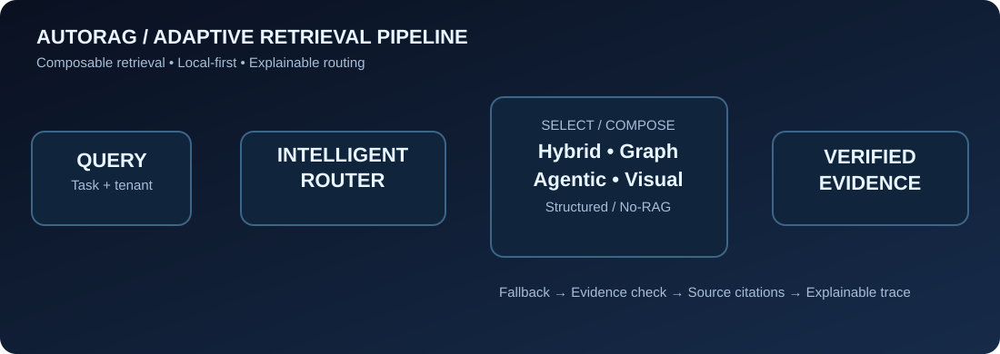

<div align="center">

# AutoRAG Router

### One query. The right retrieval strategy.

**Task-adaptive retrieval orchestration · Explainable decisions · Local-first API**

[](https://github.com/hossain0707/AutoRAG-Router/actions/workflows/ci.yml)


**[Quick start](#quick-start) · [Interactive dashboard](#interactive-dashboard) · [Architecture](#architecture) · [Documentation](docs/ARCHITECTURE.md) · [Security](#security--production-readiness)**



</div>

## Overview

AutoRAG Router is a Python framework for dynamically selecting an appropriate retrieval plan for each incoming task. Instead of using the same document-search strategy for every question, it classifies task intent, chooses from composable retrieval paths, checks evidence and exposes an auditable execution trace.

This is a **runnable, tested local-first foundation**, not a claim of fully automated enterprise-scale accuracy. It deliberately runs without GPU, paid APIs or pretrained neural models. All external model and index integrations remain future work.

### Key capabilities

- **Automatic routing:** local explainable policy selects `no_rag`, `hybrid`, `graph`, `agentic`, `multimodal` or `structured`.
- **Hybrid retrieval:** BM25 and character-trigram similarity fused with reciprocal rank fusion; neural vector retrieval is a future adapter.
- **Composable fallback:** specialized retrieval automatically falls back to hybrid when it has no results.
- **Source-aware evidence:** extractive snippets, document sources, retrieval scores and method-level traces; no invented LLM answers.
- **Local durable indexing:** SQLite-backed documents with tenant partitioning, metadata filters and upserts.
- **Developer experience:** typed FastAPI, OpenAPI at `/docs`, CLI, interactive web UI, Docker Compose and automated tests.

## Interactive dashboard

Start the API and open **http://127.0.0.1:8000**. Select **Load demo knowledge**, enter a query, and watch the engine choose the retrieval path and explain the execution.

Example task: *“How are Atlas and Beacon connected in our architecture?”* → **Graph** retrieval over explicitly tagged entity relations; if nothing is found, **Hybrid** fallback.

> The included dashboard uses synthetic example documents. It executes the real backend locally; no third-party API or paid model is needed.

## Architecture

```
User / Agent / MCP-compatible integration (future)
                    |
           FastAPI + validation
                    |
          Intent-aware task router
                    |
    +---------------+------------------+
    |               |                  |
 No retrieval   Hybrid / Graph    Decomposed / Visual /
                 retrieval         Structured retrieval
    |               |                  |
    +---------------+------------------+
                    |
         Evidence check and fallback
                    |
          Extractive source response
          + trace + request ID
```


### Strategy matrix

| Strategy | Trigger | Current backend | Notes |
| --- | --- | --- | --- |
| No-RAG | Greeting or non-document task | Skip retrieval | Does not generate a chat reply |
| Hybrid | General factual question | BM25 + char-trigram RRF | No pretrained embeddings |
| Graph | Relationship / dependency question | Entity-tag overlap | One-hop only |
| Agentic | Comparison / multi-part question | Bounded query decomposition | No autonomous tools |
| Multimodal | Diagram / PDF / image question | Caption / extracted-text search | No image encoder |
| Structured | Metric / record question | Metadata filters + hybrid | No SQL execution |
| Corrective layer | No specialized hits | Hybrid retry | Configured fallback |
| Verification layer | Retrieval finishes | Evidence score threshold | Heuristic, not factual proof |

## Quick start

### Option A — Python (Windows / macOS / Linux)

```bash
git clone https://github.com/hossain0707/AutoRAG-Router.git
cd AutoRAG-Router
python -m venv .venv
# Linux/macOS: source .venv/bin/activate
# Windows PowerShell: .venv\Scripts\Activate.ps1
pip install -e '.[dev]'
autorag serve
```

Open **http://127.0.0.1:8000** for the UI, **http://127.0.0.1:8000/docs** for interactive API docs.

### Option B — Docker Compose

```bash
cp .env.example .env
# Replace the placeholder with a secure random API key before starting.
docker compose up --build
```

The Compose configuration binds to localhost, runs as a non-root user and stores SQLite data in a named volume. Enter the configured key in the dashboard before making authenticated requests.

### Option C — CLI

```bash
autorag query "What is the annual leave policy?" --tenant demo
```

First ingest documents through the API or dashboard. See [API examples](docs/API_EXAMPLES.md).

## API in 30 seconds

```bash
curl -X POST http://127.0.0.1:8000/v1/documents \
  -H 'Content-Type: application/json' \
  -d '{"documents":[{"id":"doc-1","title":"Policy","text":"Employees receive twenty days of paid leave.","tenant_id":"demo","source":"handbook"}]}'

curl -X POST http://127.0.0.1:8000/v1/query \
  -H 'Content-Type: application/json' \
  -d '{"query":"What is the paid leave policy?","tenant_id":"demo"}'
```

With `AUTORAG_API_KEY` enabled, add `-H 'x-api-key: ...'` to each command. The JSON response includes `decision.primary`, `decision.reasons`, `hits`, `grounded`, `trace`, `latency_ms`, and `request_id`.

## Run verification

```bash
python -m pytest -q
python -m compileall -q autorag
```

Included tests cover routing, explicit overrides, persistence, local retrieval, entity tags, tenant isolation, metadata filtering, API behavior and API-key checks. GitHub Actions runs tests on Python 3.11 and 3.12.

## Security & production readiness

**Status: v0.1.0 tested developer preview, not security-certified enterprise production software.** Enterprise deployment needs identity-derived tenant authorization, rate limiting, TLS, audit logging, quotas, managed indexes and threat testing. Tenant IDs are currently client supplied; the single API key is deployment-wide rather than user-specific. Never expose the default unauthenticated server publicly. Check the full [architecture and threat model](docs/ARCHITECTURE.md).

## Planned integrations

| Area | Intended future adapters |
| --- | --- |
| Embedding and reranking | SentenceTransformers, BGE, hosted embedding services |
| Vector stores | Qdrant, pgvector, FAISS |
| Graph | Neo4j, RDF indexes |
| Agents | LangGraph, NEXUS-100, MCP |
| Documents | PyMuPDF, OCR, table extraction, vision encoders |
| Observability | OpenTelemetry, Prometheus, trace visualizations |
| Optimization | Calibrated routing model, measured quality/cost/latency objectives |

These integrations **are not included as functioning implementations in v0.1.0**.

## Promotional demo

A short cinematic demonstration can be generated from the included `scripts/make_promo.py` script (requires optional Pillow, NumPy and FFmpeg). The resulting MP4 uses synthetic scenario visuals; it is **not** a claim of independent enterprise benchmarking. The dashboard is the recommended way to test real system behavior.

## Maintainer and license

**Created and maintained by Md Najmul Hossain** · [GitHub @hossain0707](https://github.com/hossain0707)

Released under the [MIT License](LICENSE). Contributions, issues and reproducible benchmarks are welcome.
